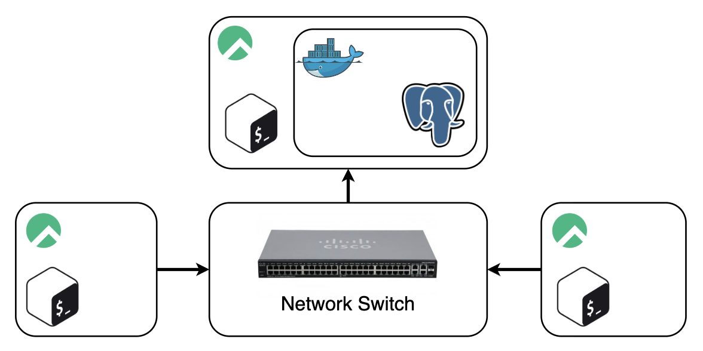

# Linux Cluster Monitoring
This project is aimed towards recording the hardware specifications and monitoring resource usage of a deployed server in real time. It helps the Jarvis Linux Cluster Administration (LCA) team to generate reports for future resource planning purposes. The design runs bash scripts using crontab and saving information to a postgreSQL instance deployed using docker across a network switch.

# Quick Start
1. We first start the psql instance using docker
```
# create a psql docker container with the given username and password.
./scripts/psql_docker.sh create db_username db_password

# start the stoped psql docker container
./scripts/psql_docker.sh start
```
2. Create PostgreSQL tables `host_info` and `host_usage` in the `host_agent` database. 
```
psql -h localhost -U postgres -d host_agent -f sql/ddl.sql
```
3. Save hardware specs data into `host_info` table. Run only once.
```
./scripts/host_info.sh "localhost" 5432 "host_agent" "postgres" "password"
```
4. Run a cronjob to save hardware usage data into `host_usage` every minute.
```
# Enter crontab using crontab -e and paste the text below. Ensure the path to file is correct.
* * * * * bash /home/rocky/dev/jarvis_data_eng_RaiyanJamil/linux_sql/scripts/host_usage.sh localhost 5432 host_agent postgres password > /tmp/host_usage.log
```

# Implemenation
## Architecture
<div align="center">

</div>

## Scripts

### psql_docker.sh
```
# script usage
./scripts/psql_docker.sh start|stop|create [db_username][db_password]

# examples
## create a psql docker container with the given username and password.
## print error message if username or password is not given
## print error message if the container is already created
./scripts/psql_docker.sh create db_username db_password

## start the stoped psql docker container
## print error message if the container is not created
./scripts/psql_docker.sh start

## stop the running psql docker container
## print error message if the container is not created
./scripts/psql_docker.sh stop
```

### host_info.sh
```
# Script usage
./scripts/host_info.sh "localhost" 5432 "host_agent" "postgres" "password"
```

### host_usage.sh using crontab
```
# Script usage - run through crontab -e
* * * * * bash /home/rocky/dev/jarvis_data_eng_RaiyanJamil/linux_sql/scripts/host_usage.sh localhost 5432 host_agent postgres password > /tmp/host_usage.log
```

## Database Modeling


### `host_info` table schema
| Column | Type | Constraints | Description |
| :--- | :--- | :--- | :--- |
| `id` | `SERIAL` | `PRIMARY KEY`, `NOT NULL` | Auto-incrementing unique identifier for the host |
| `hostname` | `VARCHAR` | `UNIQUE`, `NOT NULL` | Unique network name of the host machine |
| `cpu_number` | `INT2` | `NOT NULL` | Total number of CPU cores |
| `cpu_architecture` | `VARCHAR` | `NOT NULL` | Processor architecture (e.g., `x86_64`, `arm64`) |
| `cpu_model` | `VARCHAR` | `NOT NULL` | Specific model name of the CPU |
| `cpu_mhz` | `FLOAT8` | `NOT NULL` | CPU clock speed in megahertz (MHz) |
| `l2_cache` | `INT4` | `NOT NULL` | Size of the L2 cache in kilobytes (KB) |
| `timestamp` | `TIMESTAMP` | `NULL` | UTC timestamp when the host info was recorded |
| `total_mem` | `INT4` | `NULL` | Total available system memory in kilobytes (KB) |

### `host_usage` table schema
| Column | Type | Constraints | Description |
| :--- | :--- | :--- | :--- |
| `timestamp` | `TIMESTAMP` | `NOT NULL` | UTC timestamp when the usage metrics were sampled |
| `host_id` | `SERIAL` | `FOREIGN KEY`, `NOT NULL` | Reference ID linking to `PUBLIC.host_info(id)` |
| `memory_free` | `INT4` | `NOT NULL` | Available free memory in megabytes (MB) |
| `cpu_idle` | `INT2` | `NOT NULL` | Percentage of time the CPU spent idle |
| `cpu_kernel` | `INT2` | `NOT NULL` | Percentage of time the CPU spent running kernel processes |
| `disk_io` | `INT4` | `NOT NULL` | Number of active disk input/output operations |
| `disk_available` | `INT4` | `NOT NULL` | Available root disk space in megabytes (MB) |


# Test
Connect to psql instance:
```
$ PGPASSWORD='password' psql -h localhost -U postgres -d host_agent
psql (13.23, server 9.6.24)
Type "help" for help.

host_agent=#
```
Implement SQL commands to see that the table contains the desired information:
```
host_agent=# SELECT * FROM host_info;
 id |                                    hostname                                     | cpu_number | cpu_architecture |       
    cpu_model            | cpu_mhz | l2_cache |      timestamp      | total_mem 
----+---------------------------------------------------------------------------------+------------+------------------+-------
-------------------------+---------+----------+---------------------+-----------
  1 | jrvs-remote-desktop.northamerica-northeast2-b.c.decent-envoy-513619-t5.internal |          2 | x86_64           | Intel(
R) Xeon(R) CPU @ 2.20GHz | 2200.13 |      256 | 2026-11-10 17:23:08 |      4809
(1 row)

host_agent=# SELECT * FROM host_usage LIMIT 10;
      timestamp      | host_id | memory_free | cpu_idle | cpu_kernel | disk_io | disk_available 
---------------------+---------+-------------+----------+------------+---------+----------------
 2026-11-10 17:41:01 |       1 |        4722 |       97 |          1 |       0 |          17859
 2026-11-10 17:42:01 |       1 |        4750 |       97 |          1 |       0 |          17859
 2026-11-10 17:43:01 |       1 |        4784 |       97 |          1 |       0 |          17859
 2026-11-10 17:44:01 |       1 |        4778 |       97 |          1 |       0 |          17859
 2026-11-10 17:45:01 |       1 |        4783 |       97 |          1 |       0 |          17860
 2026-11-10 17:46:02 |       1 |        4780 |       97 |          1 |       0 |          17859
 2026-11-10 17:47:01 |       1 |        4803 |       97 |          1 |       0 |          17859
 2026-11-10 17:48:01 |       1 |        4798 |       97 |          1 |       0 |          17858
 2026-11-10 17:49:01 |       1 |        4790 |       97 |          1 |       0 |          17858
 2026-11-10 17:50:01 |       1 |        4594 |       97 |          1 |       0 |          17858
(10 rows)
```

# Deployment
The PostgreSQL instance is deployed using docker
```
# create a psql docker container with the given username and password.
./scripts/psql_docker.sh create db_username db_password

# start the stoped psql docker container
./scripts/psql_docker.sh start
```
The `host_info.sh` script is manually run once and `host_usage.sh` script is run every minute using crontab. 
```
# Script usage - run through crontab -e
* * * * * bash /home/rocky/dev/jarvis_data_eng_RaiyanJamil/linux_sql/scripts/host_usage.sh localhost 5432 host_agent postgres password > /tmp/host_usage.log
```

# Improvements
1. Include one single script to install the whole system in a new node instance.
2. Ensure postgreSQL password is shared across different nodes in a secured way.
3. Ensure that only the allowed instances can connect to the postgreSQL database.
